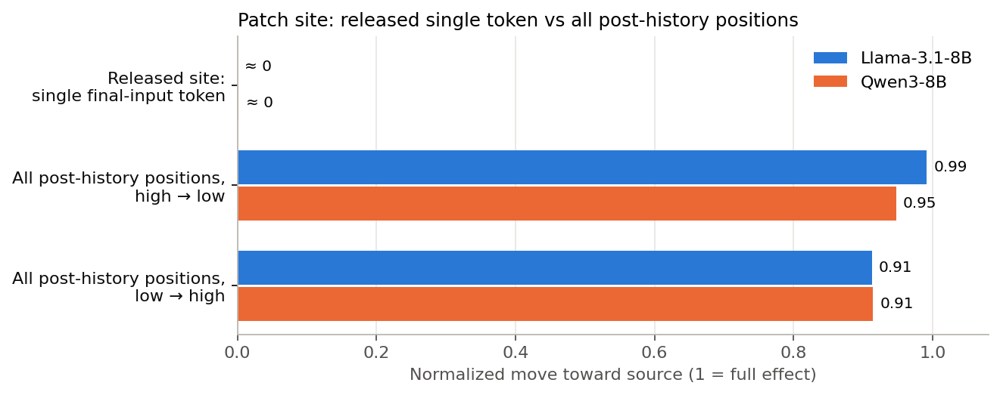
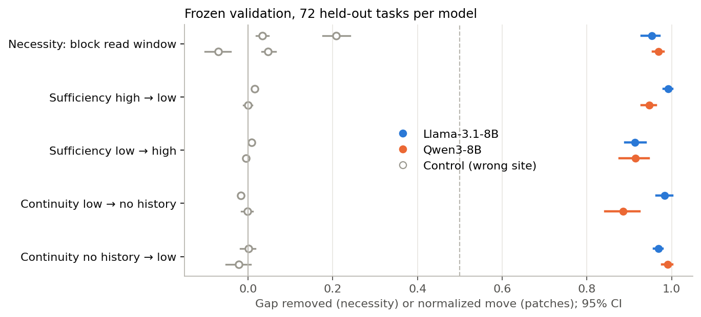
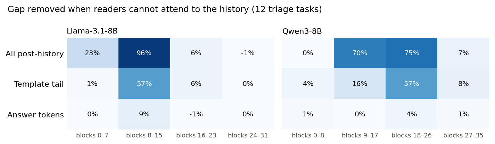
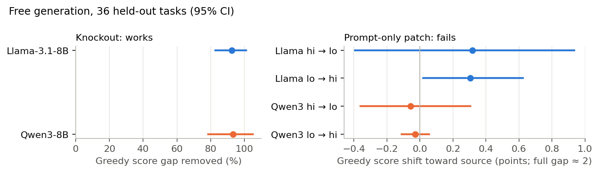

# Mech v2 TL;DR

Interactive charts: [results/mech_v2/analysis.html](results/mech_v2/analysis.html). Full log: [mech_plan_v2.md](docs/mech_plan_v2.md).

## Plan
- Find where the model keeps the effect of the score history ("10/10" vs "2/10").
- Do the search on discovery tasks only.
- Freeze the result. Then test it one time on unseen tasks.
- Do this on two models: Llama-3.1-8B and Qwen3-8B.

## What we did
1. We checked the old patching setup and the readout.
2. We blocked attention from later tokens to the history sentence, one block range at a time.
3. We split the best range into smaller ranges.
4. We patched the internal state of all tokens after the history sentence.
5. We froze the sites and the pass rules, and recorded their hashes.
6. We ran the frozen tests one time on 72 unseen tasks per model.

## What we found
- The old site was wrong. One token at one layer carries almost none of the effect (about 0%).
- The tokens after the history read it in a middle range of layers: Llama blocks 8–15, Qwen blocks 9–26.
- If we block this read, 95% (Llama) and 97% (Qwen) of the score gap goes away.
- If we patch the state after this range, 0.91 to 0.99 of the effect moves across.
- Control sites show almost no effect.
- In free text output, the block removes 92–93% of the gap. A patch of the prompt only does not change the output.
- No small set of attention heads carries the effect. The effect is spread across the range.

## What this means
- The effect is large and easy to locate. The old 20% result came from a bad patch site.
- The same mechanism occurs in two different model families. Thus, the result is not specific to Llama.
- The claim is at the level of a layer range, not of single heads.
- Generated tokens probably read the history again. We did not test this yet.

## Figures

To make the figures again: `python scripts/mech_v2_figures.py`.
